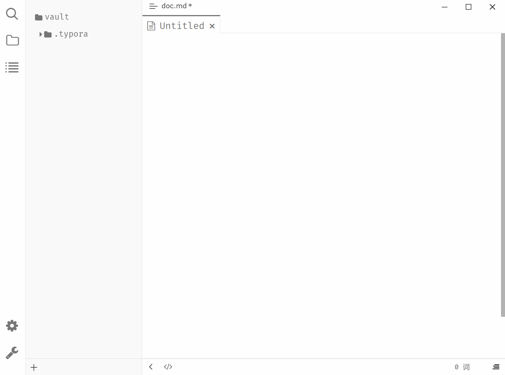
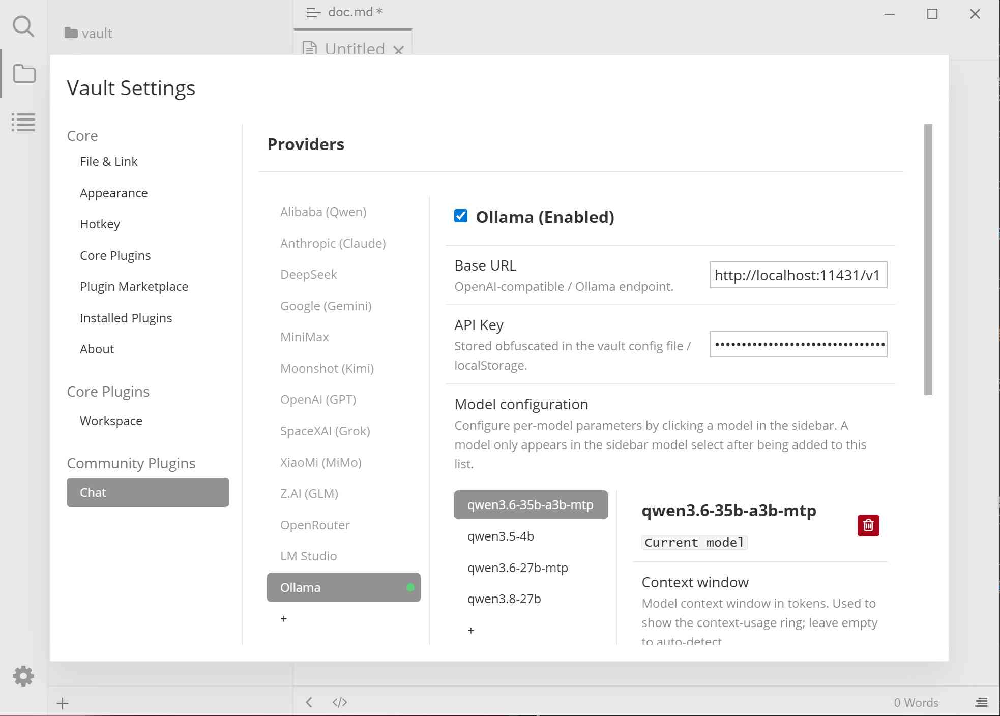

# Typora Plugin Chat

English | [中文](./README.zh-CN.md)

An AI chat assistant for Typora built on top of [typora-community-plugin][core].

Embedded in Typora, the AI chat assistant can access your vault: read, edit, create and delete files; fetch web content; run sub-agents for delegated tasks; and use reusable skills.

> **WARNING**
> 
> LLM automated operations may accidentally modify or delete your files. Please back up your versions in advance (e.g., using git).

## Preview

## Features

### Chat & Conversation
- **AI Chat Panel** — A full conversational UI in Typora's right sidebar with an auto-resizing input box, model/mode pickers, and slash command autocomplete
- **Multi-session Management** — Create, switch between, and delete independent chat sessions; transcripts persist across restarts; sessions are scoped per vault
- **"Chat About This Note"** — Send the current note's content to the AI for summarization or discussion (also available via right-click in file explorer)
- **"Send Selection to Chat"** — Send selected text into the chat with a scope constraint ("work only within this selection")

### Agent Capabilities
- **3 Access Modes**: Workspace Write (full access), Read Only, Chat Only (no file tools)
- **17+ Tools** across 4 categories: Editor, Vault, System, and Network
- **Sub-Agent System** — Delegate independent tasks to nested agent loops with inherited permissions and turn-scoped undo/redo
- **Skills System** — Auto-discover and invoke reusable SKILL.md instruction sets from your vault or global directories
- **AGENTS.md Support** — The vault-root `AGENTS.md` is injected into the system prompt so project conventions apply to every agent turn (main loop + sub-agents)

### Smart Features
- **Slash Commands**: `/new`, `/sessions`, `/skill:<name>`, `/undo`, `/redo` with keyboard-navigable autocomplete
- **Undo/Redo** — Turn-scoped atomic undo *within the current session*: all file changes from one agent turn are rolled back together
- **Context Window Usage Ring** — Real-time visual indicator of token usage vs. context window size (estimated or API-reported)

### Tool Enhancements
- **Pagination Support** — `list_files`, `web_fetch` and other tools support limit/offset pagination to avoid returning too much content at once
- **Forbidden Path Policy** — Configure glob patterns to block the agent from accessing sensitive directories and files (`.git`, `node_modules`, `*.apikey` are always forbidden)
- **Directories in list_files** — Non-recursive `list_files` returns both files and directories

### AI Providers
- **Anthropic (Claude)** — `/v1/messages` endpoint with tool use, thinking blocks, and token reporting
- **OpenAI (GPT)** — Responses API (default) or Chat Completions fallback mode
- **Alibaba (Qwen) / DeepSeek / Google (Gemini) / MiniMax / Moonshot (Kimi) / SpaceXAI (Grok) / Xiaomi (MiMo) / Z.AI (GLM) / OpenRouter** — via standard `/v1/chat/completions` (OpenAI-compatible)
- **Ollama / LM Studio** — Local models in the standard `/v1/chat/completions` format

## Settings

| Setting | Description |
|---------|-------------|
| **Provider Configuration** | Built-in Anthropic, OpenAI, Alibaba (Qwen), DeepSeek, Google (Gemini), MiniMax, Moonshot (Kimi), SpaceXAI (Grok), Xiaomi (MiMo), Z.AI (GLM), OpenRouter, Ollama, and LM Studio; add/remove custom providers. Each provider can be enabled/disabled with independent API Key, Base URL, and model configuration |
| **Model Parameters** | Configure parameters such as context window size per model; only models added to the list appear in the sidebar's model picker dropdown |
| **Forbidden Paths** | Glob patterns (one per line) to block the agent from accessing specified vault paths (`.git`, `node_modules`, `*.apikey` are always forbidden) |
| **Max Tool Iterations** | Max tool-call rounds in one agent loop (default 20, range 1-100) |
| **Skills** | SKILL.md files auto-loaded from the specified directories; invoke with `/skill:<name>` in chat or let the model match automatically |

## Install

1. Install [typora-community-plugin][core]
2. Open "Settings -> Community Plugins", search for "Chat", then install it.

[core]: https://github.com/typora-community-plugin/typora-community-plugin
